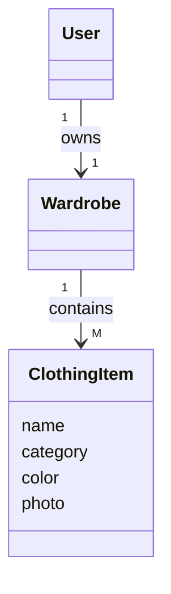
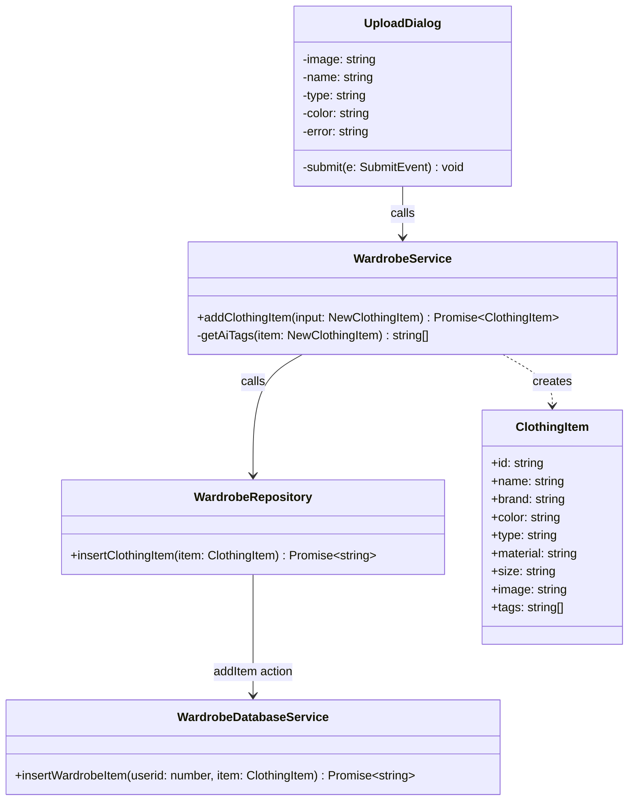
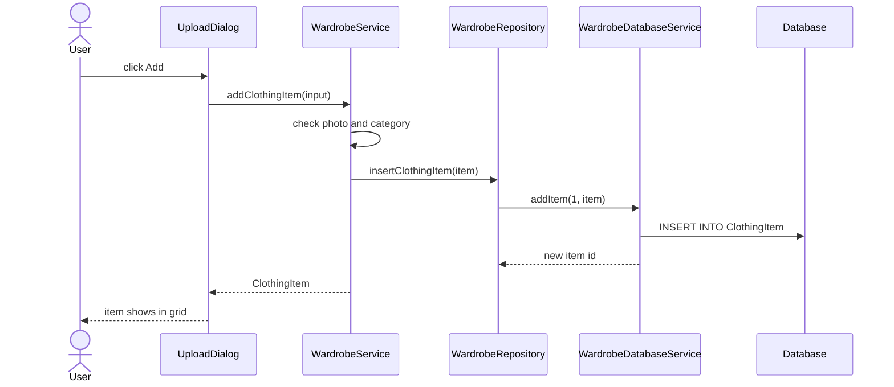
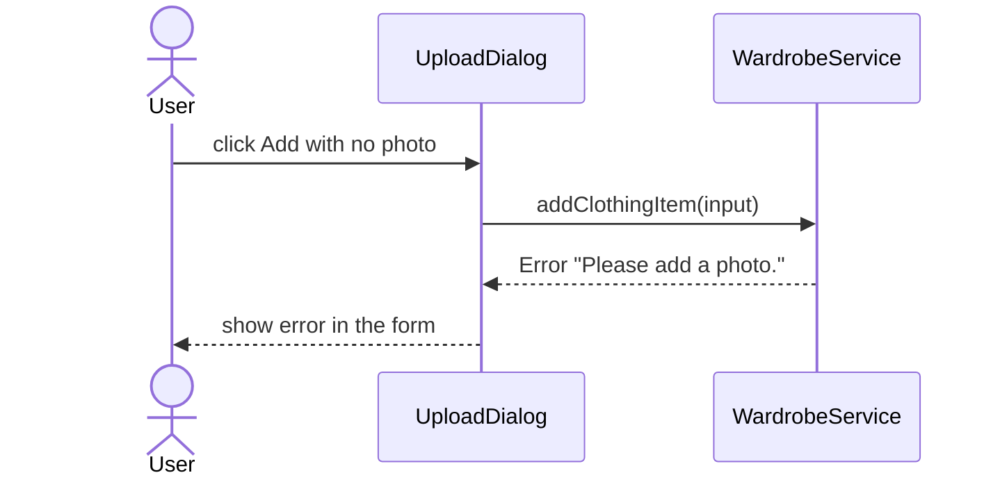

# Add Button (Upload Clothing Item) - Design Diagrams

Issue #26. Code: `UploadDialog.tsx`, `wardrobeService.ts`, `wardrobeRepository.ts`, `wardrobeActions.ts`, `WardrobeDatabaseService.ts`.

## 1. Conceptual class diagram

## 2. Detailed class diagram

Layers:

- `UploadDialog` is the UI layer.
- `WardrobeService` is the application layer.
- `WardrobeRepository` and `WardrobeDatabaseService` are the persistence layer.

## 3. Sequence diagram - item added

## 4. Sequence diagram - missing photo

